<p align="center">
  
</p>

<p align="center">
  <strong>Your GitHub contribution grid, on a radar screen</strong>
</p>

<p align="center">
  <a href="https://github.com/marketplace/actions/flight-path-radar">
    
  </a>
  <a href="https://nodejs.org/">
    
  </a>
  <a href="https://opensource.org/licenses/MIT">
    
  </a>
  
</p>

<h1>Flight Path Radar</h1>

<p>Flight Path Radar is a GitHub Action that turns your contribution grid into a radar screen. A stealth plane flies a route through every day you contributed, and each blip gets an amber lock-on box and goes dark as the plane passes over it. It flies slowly between nearby blips and speeds up across empty stretches.</p>

<p>The output is a single animated SVG with no JavaScript, so it plays inside a plain <code>&lt;img&gt;</code> tag on your GitHub profile README.</p>

<p>Inspired by <a href="https://github.com/Platane/snk">Platane/snk</a>, the contribution-grid snake. Flight Path Radar is a separate project that keeps the same idea and swaps the snake for aircraft.</p>

<h2>Features</h2>

<ul>
  <li><strong>Radar-screen look:</strong> dark scope with grid lines, dashed range rings, a crosshair and a rotating sweep</li>
  <li><strong>Two themes:</strong> the radar scope on its own, or a <code>cockpit</code> frame that matches <a href="https://github.com/maxhayim/cockpit-telemetry">Cockpit Telemetry</a> (see the <a href="#gallery">Gallery</a>)</li>
  <li><strong>Five planes</strong>, chosen per output file with <code>?plane=</code>: B-2 Spirit, F-117 Nighthawk, F-22 Raptor, SR-71 Blackbird and a Biplane (see the <a href="#gallery">Gallery</a>)</li>
  <li><strong>Variable speed:</strong> slow between neighbouring blips, eased acceleration across long gaps</li>
  <li><strong>Lock-on effect:</strong> each contributed day flashes amber and goes dark as the plane passes, with a dotted track left behind</li>
  <li>Busiest days glow brighter than quieter ones, using GitHub's own four contribution levels</li>
  <li>Several output files in one run, each with its own plane</li>
  <li><strong>Any calendar year or date range</strong>, not just the last 12 months (see <a href="#calendar-year-and-date-ranges">Calendar Year and Date Ranges</a>)</li>
  <li><strong>Zero dependencies:</strong> plain Node.js, nothing to install</li>
  <li>Works with the built-in <code>GITHUB_TOKEN</code>, and falls back to the public contributions page when no token is set</li>
</ul>

<h2>Gallery</h2>

<p>Every example below is live output from this Action. Pick a plane and a theme, then copy the setting under its preview into your workflow. You can mix them, e.g. <code>dist/flight-path.svg?plane=sr71&amp;theme=cockpit</code>.</p>

<p><strong>Planes:</strong> <a href="#b2">B-2 Spirit</a> · <a href="#f117">F-117 Nighthawk</a> · <a href="#f22">F-22 Raptor</a> · <a href="#sr71">SR-71 Blackbird</a> · <a href="#biplane">Biplane</a><br>
<strong>Themes:</strong> <a href="#radar">Radar</a> · <a href="#cockpit">Cockpit</a> · <a href="#cockpit-without-titles">Cockpit without titles</a></p>

<h3 id="planes">Planes</h3>

<p>Set with <code>?plane=&lt;name&gt;</code> on an output, or the <code>plane</code> input. Shown here in the radar theme.</p>

<h4 id="b2">B-2 Spirit</h4>

<p>Flying wing with a sawtooth trailing edge. The default. Use <code>plane: b2</code> or <code>?plane=b2</code>.</p>

<p align="center"></p>

<h4 id="f117">F-117 Nighthawk</h4>

<p>Faceted arrowhead with a notched tail. Use <code>plane: f117</code> or <code>?plane=f117</code>.</p>

<p align="center"></p>

<h4 id="f22">F-22 Raptor</h4>

<p>Diamond wings and angled tailplanes. Use <code>plane: f22</code> or <code>?plane=f22</code>.</p>

<p align="center"></p>

<h4 id="sr71">SR-71 Blackbird</h4>

<p>Long chined fuselage, delta wing and two engine nacelles. Use <code>plane: sr71</code> or <code>?plane=sr71</code>.</p>

<p align="center"></p>

<h4 id="biplane">Biplane</h4>

<p>Stacked wings and a spinning propeller. Use <code>plane: biplane</code> or <code>?plane=biplane</code>.</p>

<p align="center"></p>

<h3 id="themes">Themes</h3>

<p>Set with <code>?theme=&lt;name&gt;</code> on an output, or the <code>theme</code> input. Shown here with the B-2.</p>

<h4 id="radar">Radar</h4>

<p>The default: the radar scope on its own, sized to your contribution grid. Use <code>theme: radar</code> or <code>?theme=radar</code>.</p>

<p align="center"></p>

<h4 id="cockpit">Cockpit</h4>

<p>960px wide and framed to sit with <a href="https://github.com/maxhayim/cockpit-telemetry">Cockpit Telemetry</a>: the same header, bezel panel, corners, colours and annunciator strip. Use <code>theme: cockpit</code> or <code>?theme=cockpit</code>.</p>

<p align="center"></p>

<h4 id="cockpit-without-titles">Cockpit without titles</h4>

<p>The cockpit theme with the header (the <code>FLIGHT PATH RADAR</code> title, your callsign and the time span) and the panel title hidden. The panel moves up to fill the space; the annunciator strip stays. Use <code>titles: false</code> or <code>?theme=cockpit&amp;titles=false</code>. The radar theme has no visible titles, so this option has no effect there.</p>

<p align="center"></p>

<h2>Requirements</h2>

<ul>
  <li>A GitHub profile repository (<code>&lt;you&gt;/&lt;you&gt;</code>) with Actions enabled</li>
  <li>Workflow permission <code>contents: write</code>, so the SVG can be pushed to an <code>output</code> branch</li>
  <li>Node.js 20 or newer, only if you run it locally (the Action sets Node up for you)</li>
</ul>

<h2>Installation and Setup</h2>

1. In your profile repository, create `.github/workflows/flight-path.yml`:

   ```yaml
   name: Flight Path Radar

   on:
     schedule:
       - cron: "0 */12 * * *"   # every 12 hours
     workflow_dispatch:

   permissions:
     contents: write

   jobs:
     build:
       runs-on: ubuntu-latest
       steps:
         - uses: maxhayim/flight-path-radar@v1
           with:
             github_user_name: ${{ github.repository_owner }}
             outputs: |
               dist/flight-path.svg
               dist/flight-path-f117.svg?plane=f117
            dist/flight-path-cockpit.svg?theme=cockpit

         - uses: crazy-max/ghaction-github-pages@v4
           with:
             target_branch: output
             build_dir: dist
           env:
             GITHUB_TOKEN: ${{ secrets.GITHUB_TOKEN }}
   ```

2. Run the workflow once from the **Actions** tab (**Run workflow**), or wait for the schedule.

3. Add the image to your profile `README.md`:

   ```html
   /<you>/output/flight-path.svg" alt="Flight Path Radar" width="100%">
   ```

<h2>Usage</h2>

<h3>Inputs</h3>

<table>
  <tr><th>Input</th><th>Default</th><th>Description</th></tr>
  <tr><td><code>github_user_name</code></td><td>(required)</td><td>User whose contribution grid to fly over.</td></tr>
  <tr><td><code>outputs</code></td><td><code>dist/flight-path.svg</code></td><td>One file per line. Add <code>?plane=&lt;name&gt;</code>, <code>?theme=&lt;name&gt;</code> and/or <code>?titles=false</code> to set them for that file, e.g. <code>dist/flight-path.svg?plane=f117&amp;theme=cockpit</code>.</td></tr>
  <tr><td><code>plane</code></td><td><code>b2</code></td><td>Plane for outputs that don't set <code>?plane=</code>.</td></tr>
  <tr><td><code>theme</code></td><td><code>radar</code></td><td>Theme for outputs that don't set <code>?theme=</code>: <code>radar</code> or <code>cockpit</code>.</td></tr>
  <tr><td><code>titles</code></td><td><code>true</code></td><td>Set to <code>false</code> to hide the cockpit theme's header (title, callsign, time span) and panel title.</td></tr>
  <tr><td><code>year</code></td><td>(empty)</td><td>Calendar year to show, e.g. <code>2025</code>. Can't be combined with <code>from</code>/<code>to</code>.</td></tr>
  <tr><td><code>from</code></td><td>(empty)</td><td>Start date (<code>YYYY-MM-DD</code>) of a custom range.</td></tr>
  <tr><td><code>to</code></td><td>(empty)</td><td>End date (<code>YYYY-MM-DD</code>) of a custom range. Defaults to one year after <code>from</code>, or today.</td></tr>
  <tr><td><code>github_token</code></td><td><code>github.token</code></td><td>Token used to read the contribution calendar.</td></tr>
</table>

<h3>Calendar Year and Date Ranges</h3>

<p>By default the grid covers the last 12 months, the same as your GitHub profile. Set <code>year</code> to show a whole calendar year, or <code>from</code>/<code>to</code> for a custom range:</p>

```yaml
      - uses: maxhayim/flight-path-radar@v1
        with:
          github_user_name: ${{ github.repository_owner }}
          year: 2025
          outputs: dist/flight-path-2025.svg
```

```yaml
      - uses: maxhayim/flight-path-radar@v1
        with:
          github_user_name: ${{ github.repository_owner }}
          from: 2026-03-01
          to: 2026-09-30
          outputs: dist/flight-path-summer.svg
```

<p>GitHub only returns up to one year of contributions per request, so a range can be at most one year long. If you set only <code>from</code>, the range runs one year forward (or to today); if you set only <code>to</code>, it runs one year back.</p>

<h3>Running Locally</h3>

<pre><code>git clone https://github.com/maxhayim/flight-path-radar.git
cd flight-path-radar
GITHUB_TOKEN=$(gh auth token) node src/cli.mjs &lt;user&gt; 'out/flight-path.svg?plane=sr71'
GITHUB_TOKEN=$(gh auth token) node src/cli.mjs --year 2025 &lt;user&gt; out/flight-path-2025.svg
GITHUB_TOKEN=$(gh auth token) node src/cli.mjs --from 2026-03-01 --to 2026-09-30 &lt;user&gt; out/summer.svg</code></pre>

<p>Without <code>GITHUB_TOKEN</code> it reads the public contributions page instead.</p>

<h2>How It Works</h2>

<ol>
  <li><strong>Fetch the grid.</strong> The contribution calendar is read from the GitHub GraphQL API (or the public contributions page), for the last 12 months or the chosen year or range, giving every day's position and contribution level.</li>
  <li><strong>Plan the route.</strong> Starting off the left edge, the plane visits the nearest unvisited contributed day each time, then exits to the right. The route is smoothed into curves so the plane banks through turns.</li>
  <li><strong>Time the flight.</strong> Each hop is slow for its first two cells and fast beyond that, with eased acceleration on long hops. Every lock-on effect and the dotted track are timed to the same schedule.</li>
  <li><strong>Render.</strong> Everything is written as SVG animation (<code>animateMotion</code>, <code>animate</code>), so the file plays on its own in any browser and inside GitHub's image proxy.</li>
</ol>

<h2>Known Limitations</h2>

<ul>
  <li><strong>Dark only.</strong> Both themes are designed for dark backgrounds, so they stand out as a dark panel on GitHub's light theme.</li>
  <li><strong>Loop length depends on your activity.</strong> More contributed days means a longer loop, often a minute or more.</li>
  <li><strong>Private contributions</strong> only count if you have enabled "Include private contributions on my profile" in your GitHub settings.</li>
  <li><strong>Profile image caching.</strong> GitHub caches README images, so a fresh SVG can take a few minutes to show on your profile.</li>
</ul>

<h2>License</h2>

This project is licensed under the MIT License.

See the [LICENSE](LICENSE) file for details.  
Full license text: https://opensource.org/licenses/MIT

<h2>Contributing</h2>

<p>Pull requests are welcome. Open an issue first to discuss ideas or report bugs.</p>

<h2>Related Projects</h2>

<ul>
  <li><a href="https://github.com/Platane/snk">Platane/snk</a>: the contribution-grid snake that inspired this project</li>
  <li><a href="https://github.com/maxhayim/cockpit-telemetry">maxhayim/cockpit-telemetry</a>: animated glass-cockpit dashboard of your GitHub stats; the <code>cockpit</code> theme is designed to sit alongside it</li>
  <li><a href="https://github.com/Platane/snk/pull/205">Platane/snk#205</a>: the calendar year and date range proposal that inspired the <code>year</code>/<code>from</code>/<code>to</code> inputs</li>
  <li><a href="https://github.com/crazy-max/ghaction-github-pages">crazy-max/ghaction-github-pages</a>: used in the example workflow to publish the SVG</li>
</ul>

<h2>Acknowledgments</h2>

<p>Inspired by <a href="https://github.com/Platane/snk">Platane/snk</a> by Platane.<br>
GitHub® is a trademark of GitHub, Inc. and is used here solely for interoperability purposes. Aircraft names are used descriptively.
All other trademarks are the property of their respective owners.</p>
